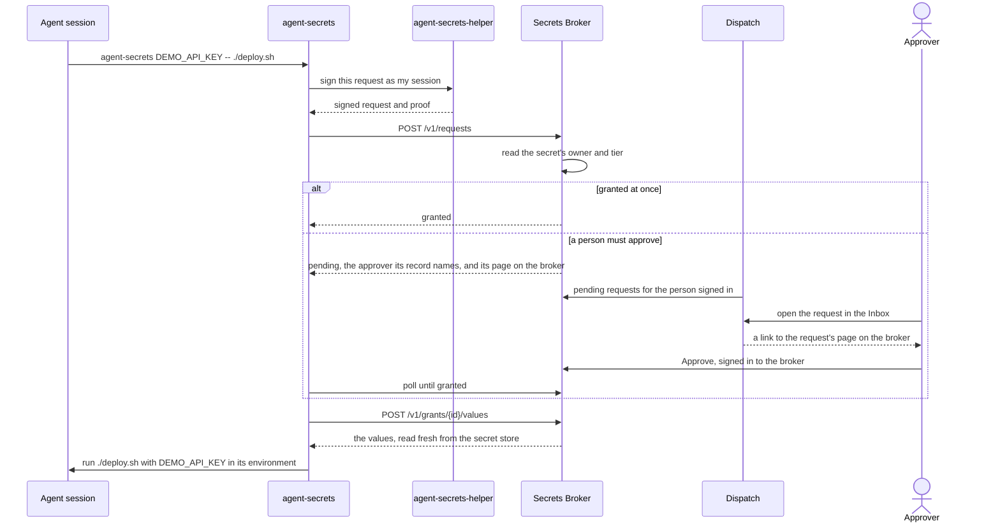

The Secrets Broker hands agent sessions the secret values they need, one request at a time, so an
agent never holds a long-lived API key. An agent asks for a secret by name; the broker decides from
the secret's owner and tier whether to grant it at once, refuse it, or ask a person; and the person
approves or denies it on the broker's own page, which their Dispatch Inbox links to. A granted
value reaches only the session that asked, in the
environment of the command it runs, and every request, decision and use is recorded. That command
is the agent's choice and can read the value, so approve a secret only for a session you would
trust with the value itself. The command keeps the value in its environment for as long as it runs;
the grant's expiry or revocation stops the session from reading the value again, not a command that
already has it, and once the session's own person revokes a grant it got without asking, that
session asks before it gets those secrets again.

```sh
agent-secrets DEMO_API_KEY --reason "Deploy the example service" -- ./deploy.sh
```

That one command is all an agent runs. Everything else on this page explains what happens behind
it.

## Why it exists

- **No long-lived keys in agents.** An agent's environment, transcript and tools are the easiest
  place for a key to leak. With the broker, an agent session holds only a signing key of its own
  that dies with the session, and fetches a value for exactly the command that needs it.
- **A person approves what needs approval.** Each secret's owner and tier, two tags on the secret
  itself, say who gets it automatically and who needs a person's yes. The request waits in that
  person's Dispatch Inbox, where they already work, and one click there opens its page on the
  broker, where one more click approves it.
- **Every grant is recorded.** Each approval rests on a signed, content-addressed record of who
  asked, for what, why, and who decided, which the broker re-verifies every time it releases a
  value.

## How a request flows



On a machine, `agent-secrets-helper` holds each agent session's key and signs for it. In a
container (a **box**) the container holds its own key, and in Kubernetes each Legion worker pod
does; the request flow is the same. [Run an agent in a
container](/legion/broker/guides/run-an-agent-in-a-container/) shows a box's setup.

## The pieces

| Piece | What it does | Where it runs |
| --- | --- | --- |
| Secrets Broker (`envoy-broker`) | Enrolls sessions, decides each request from the secret's owner and tier, records requests and decisions, and releases granted values. | One or more identical stateless processes behind one address, beside Postgres and the secret store. |
| `agent-secrets` | The command an agent runs to use a secret, the tool people and launchers use to log machines in and inspect sessions, the tool people list and revoke their machine logins and live grants with (`machine list`, `grant list`), and the tool people manage the secrets themselves with, under their own cloud sign-in. | Wherever agents run, and a person's own machine. |
| `agent-secrets-helper` | A per-user daemon that holds each host agent session's key, enrolls it, and signs for it. | Each machine that runs agents directly. |
| Dispatch | Shows people the requests waiting on them, each secret request linking to its page on the broker; takes a machine login's typed code and relays the person's decision; and lists the grants people can revoke. | Dispatch's server and web app. |
| Legion | Enrolls every worker pod it runs on Kubernetes, so a phase worker can use `agent-secrets` like any other session. | Legion's daemon. |

## How it fits with Legion and Dispatch

[Dispatch](/legion/dispatch/) is where people see what waits on them: its Inbox lists **Credential
requests** beside the asks waiting on them, each secret request a link to its page on the broker,
its machine-login page takes a machine's code, and its Settings page lists the live grants a person
can revoke. A person approves a secret request on the broker's own page, signed in to the broker
itself, never through Dispatch. The broker holds no Dispatch credential; Dispatch's server reads
what waits on the signed-in person, and relays that person's machine-login decisions and revokes.

[Legion](/legion/legion/) runs agents. When its Kubernetes runtime is configured with the broker,
the Legion daemon logs itself in with its own Kubernetes ServiceAccount token, which no person
approves, and enrolls every worker pod it starts, so each pod's agent gets only the grants of that
pod. See [how Legion, Dispatch and the broker fit together](/legion/how-it-fits/).

## Where to go next

- [Quickstart](/legion/broker/quickstart/): use a secret from an agent session, and see what the
  approver sees.
- [Walkthrough](/legion/broker/walkthrough/): one secret request, from the agent's ask through its
  approval on the broker's own page to the command that runs with it.
- [Concepts](/legion/broker/concepts/): sessions, machine logins, owner and tier, grants, approvals
  and the audit record.
- Guides: [manage a secret](/legion/broker/guides/manage-a-secret/),
  [create a GitHub App for a development box](/legion/broker/guides/github-app-for-a-dev-box/),
  [approve a request](/legion/broker/guides/approve-a-request/),
  [log a machine in](/legion/broker/guides/log-a-machine-in/),
  [run an agent in a container](/legion/broker/guides/run-an-agent-in-a-container/),
  [revoke a session or a grant](/legion/broker/guides/revoke-a-session/), from Dispatch or from your
  shell (`agent-secrets machine list`, `agent-secrets grant list`),
  [run the broker locally](/legion/broker/guides/run-locally/), and
  [troubleshooting](/legion/broker/guides/troubleshooting/).
- [Operating the broker](/legion/broker/operate/): configuration, dependencies, health and logs.
- Reference, generated from the code: [`agent-secrets` CLI](/legion/broker/reference/cli/),
  [HTTP API](/legion/broker/reference/api/), [configuration](/legion/broker/reference/config/),
  and [error codes](/legion/broker/reference/errors/).
