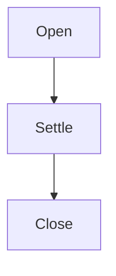

# A synthetic document of 28 sections

The ledger holds three leases, and the window closes once the last of them has settled, so a
reader who opens this document late still reads the same order of events as the reader who
opened it first.

## 1. The lease window

Some *emphasis*, **strong**, `code`, ~~withdrawn~~, and a [link](https://example.test/a "Title").

### What it holds

- The window opens on the first lease.
- The window closes on the last.
- Nothing is read between them.

| Lease | Opens | Closes |
| --- | :-: | ---: |
| First | 00:01 | 00:09 |
| Last | 00:04 | 00:12 |

```ts
const window = leases.map((lease) => lease.opens);
```



## 2. The settlement

A second section, so the cut has more than one heading to reach past.
